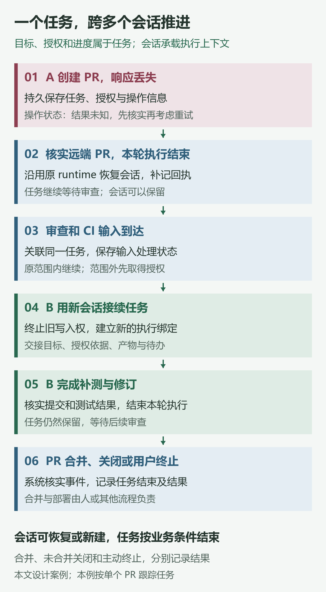
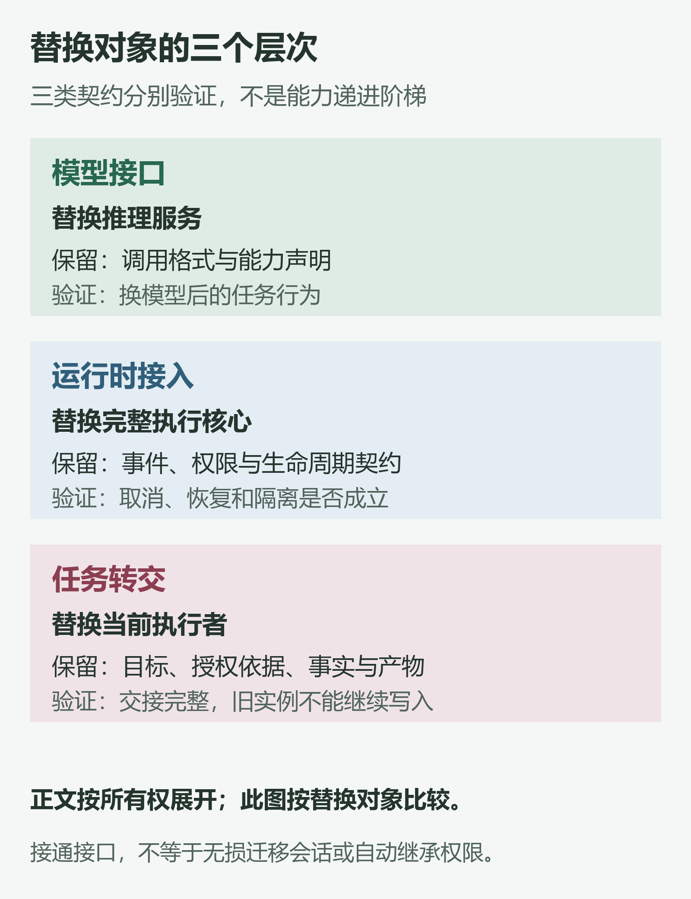

Anthropic 在 [Managed Agents 的架构文章](https://www.anthropic.com/research/managed-agents)里提到一个例子：Claude Sonnet 4.5 接近上下文上限时，有时会提前结束工作。团队把这种行为称为“上下文焦虑”（context anxiety），并通过重置上下文来缓解。

换成 Claude Opus 4.5 后，他们发现这个问题消失了，原先的重置机制也不再需要。

模型升级会让一些执行策略过时，但运行中的任务仍要应对进程崩溃、工具超时和结果丢失。模型再强，遇到一次超时的调用，系统也得核实它究竟有没有成功。

因此，**harness 需要让规划、检索和上下文策略保持可替换，同时独立保存任务、授权与执行事实。** 上下文被压缩、进程被替换之后，后续执行仍要有据可查。这种状态分离可以在同一个服务内实现，是否拆分服务则取决于实际的运行与协作需求。

下面用一项假想任务串起这些问题：用户授权 agent 修复当前仓库的接口超时、补充测试并提交 PR，**不包含合并和部署**。

文中的“执行器”指实际承担这次工作的 agent 运行实例，它使用选定的 runtime，并绑定会话和执行环境。任务与执行器的绑定关系，后文称为 Assignment。假设执行过程中接连发生了这些事：

> 创建 PR → 成功响应丢失 → 执行器重启 → 次日审查追加要求 → 更换执行器继续处理。

要让工作继续，系统需要回答三个问题：进程退出后，状态和环境如何管理？换一个 harness，宿主怎样接入？跨过多个会话之后，任务由谁持续管理？下文按这三个问题展开，讨论的流程是架构建议，具体产品的实现范围会另行说明。

## 最贴近模型的地方，未必最稳定

讨论 agent 时，常见的起点是 [ReAct](https://arxiv.org/abs/2210.03629)：模型提出行动，环境返回观察，模型再据此选择下一步。这解释了行动循环如何推进；存储、恢复和权限还需要运行系统来处理。

本文用 harness 指围绕模型组织工具、上下文、执行控制、状态与验证的运行系统，用 runtime 指其中负责实际执行和生命周期管理的核心。行业用法有所重叠，阅读时可以先看具体职责：ReAct 描述行动如何组织，runtime 管理执行，沙箱约束代码和工具能访问的环境。

**请求格式没变，模型的行为也可能变。** 新模型对工具说明、长历史和停止条件的反应可能不同。即使 SDK 调用仍能通过类型检查，原有策略也需要重新验证。

判断一个组件是否值得保留，可以分两步：

1. **模型进步之后，这项责任是否仍然存在？**
2. **这项责任由谁承担，需要怎样的接口、生命周期和权限边界？**

例如，重启后找回 PR 任务始终是系统的责任，存储可以选择本地日志、嵌入式数据库或托管服务。授权也一样：prompt 可以告诉模型工作范围，宿主和外部系统还得限制它实际能做什么。

同一项责任可以更换实现，同一套接口也可以放在进程内或独立服务中。是否拆分，要看各部分需要怎样的生命周期、故障隔离和权限控制。

*PR 任务的恢复与交接示意。业务授权决定工作范围，执行器权限决定实际能做什么，PR 审查批准则是代码评审结论；三者分别生效。*

## 第一条边界：让状态和环境不再依附一个进程

模型服务适配层（provider）让推理服务更容易替换，[MCP](https://www.anthropic.com/news/model-context-protocol)和 [Agent Skills](https://www.anthropic.com/research/equipping-agents-for-the-real-world-with-agent-skills)分别让工具连接与操作知识更容易复用。PR 创建响应丢失时，还有一个更迫切的问题：如果执行进程随后退出，系统还知道这次操作的哪些信息？

### Managed Agents 如何拆分运行职责 {#managed-agents-拆开的不是另一种模型接口}

Anthropic 的 Managed Agents 架构文章，将系统分成三类对象：

- **Brain**：模型与 harness 组成的决策循环。
- **Hands**：实际运行代码、操作文件和访问服务的沙箱与工具。
- **Session**：独立保存的会话事件日志。

这三部分有不同的使用时机和生命周期。把它们绑在一起，就连故障和恢复也会相互牵连。

放在同一个容器里，文件操作很方便，但容器失效可能连带丢失会话；暂时不需要计算环境的任务也得等待容器初始化；模型生成的代码还可能接触同一环境中的控制凭据。

拆开之后，沙箱可以按需创建，故障通过工具调用返回，会话记录仍然保留。harness 进程失效时，也可以依据外部日志恢复。原文还介绍了凭据隔离：MCP OAuth 凭据保存在沙箱之外的安全存储（vault）中，由专用代理取用并调用外部服务。

原文用 `execute(name, input)` 说明“手”的调用接口。这个接口隐藏了环境差异，背后仍需要操作系统隔离、网络与文件权限控制，以及凭据代理。拆分的作用是让这些机制有明确的负责方。

把终端、Web 和 IDE 接到同一个服务，解决的是 UI 与执行核心的关系。日志、循环和工具环境是否独立，还要继续检查它们各自的生命周期。

### 日志保存历史，上下文服务当前推理 {#会话日志不是模型当前的上下文}

**日志保存可回查的历史，上下文则是当前这一步推理需要的视图。**

压缩可以改变这个视图，原始事实仍应保留。换一种上下文策略时，系统可以重新读取日志；确认 PR 是否创建成功，也要查操作记录和远端状态。模型摘要里的一句“可能已经创建”，不足以作为回执。

执行器 A 发出创建 PR 的请求前，应先持久化仓库、head/base 分支、提交版本和本次操作的关联标识。响应超时后，把操作标为**结果未知**，保留核实的依据。即使 A 随后崩溃，这些记录也必须能被找回。

重启时，宿主先确认旧实例不会继续写入，再恢复原有会话或交给新实例接手。恢复流程要查询远端 PR，用仓库、分支等信息核实结果。找到唯一匹配后，补记 PR 链接和回执。

如果查不清结果，就保持待核实状态。只有证实操作未发生，或外部接口明确提供幂等保证时，才考虑重试。内部关联标识便于追踪操作，远端能否去重仍取决于外部接口。

更换执行实例时，任务目标和授权记录继续保留，恢复流程还要检查权限是否过期或被撤销。

## 第二条边界：Harness 自己成为可组合的部件

PR 已确认存在，A 进入等待审查的阶段。如果接下来想换成使用另一个 runtime 的执行器 B，宿主需要怎样接入它？

### 可嵌入应用的执行核心 {#产品往下提供-sdk框架往上提供-harness}

[Claude Agent SDK](https://platform.claude.com/docs/en/cli-sdks-libraries/overview)、[GitHub Copilot SDK](https://github.blog/changelog/2026-06-02-copilot-sdk-is-now-generally-available/)，以及 [Codex 的 SDK 与 app-server](https://developers.openai.com/blog/codex-as-a-platform)，都在让应用直接接入产品已有的执行核心。

应用可以借此使用工具调用、上下文处理、会话管理和执行事件等能力。各 SDK 对取消、恢复与授权的处理方式不同，接入时仍要逐项确认。

框架也在补齐这些能力。Deep Agents 等项目把规划、文件系统、子 agent 和上下文处理封装在一起，减少开发者自行拼装的工作。产品和框架由不同起点，逐渐提供相近的运行功能。

[Barbaste 等人的源码研究](https://arxiv.org/html/2609.00006v1#S14.SS2)用“harness 与 framework 的合流”描述这种变化。该研究主要采样 **2026 年 7 月**版本，并与 4 月快照比较；Claude Code 部分基于 **3 月的非官方流传快照**，不能把这些观察当作 11 月所有产品的现状。

开发者可以选用一个现成的运行核心，再接入业务工具和约束。能否换掉这个核心，取决于接口是否明确约定了行为、状态和生命周期，与代码多少没有必然关系。

### ACP：从编辑器接口到运行后端接口

[ACP](https://agentclientprotocol.com/get-started/introduction)主要用于客户端与 coding agent 之间的通信，涉及会话、进度、权限和取消等交互。宿主调用一个执行器时，也需要处理这些事情。

Barbaste 等人的[比较](https://arxiv.org/html/2609.00006v1#S13.SS3)记录了这种用法：在研究采样的版本中，OpenHands 通过 ACP 接入外部 agent，让 Claude Code、Codex 或 Gemini CLI 承担会话中的实际执行。

同一研究还讨论了把 agent 封装成模型兼容 API 的做法。调用方看起来是在请求模型，下游却可能运行着完整的工具循环：修改文件、等待审批，或启动后台作业。因此，宿主需要知道取消请求会停止哪些工作、哪些动作已经生效。仅取消 HTTP 请求，无法保证后台作业终止，也无法撤销已经发生的操作。

### Omnigent 如何接入多个运行后端 {#omnigent统一的是工作入口不是所有内部实现}

[Omnigent](https://github.com/omnigent-ai/omnigent)将自己定位为 meta-harness：在多个原生 harness 之上，提供共同的编排、策略、沙箱和协作入口。

宿主可以在同一个入口下选择执行后端，让一个执行器实现、另一个审查，并统一管理会话共享和公共策略。

Barbaste 的[分析](https://arxiv.org/html/2609.00006v1#S14.SS4)还记录了它如何核验适配器声明的能力：通过一致性探针检查基础执行、工具调用、流式输出、中断、指定模型和策略拒绝等行为。适配器支持什么，要以实际测试结果为准。

各 runtime 特有的计划、模式等状态，可以通过扩展接口暴露。遇到不支持的能力，接口应明确返回，让宿主决定如何处理。

隔离机制也有差异。在该研究快照中，Omnigent 对某些后端使用自己的沙箱包装，对 Codex 则委托原生沙箱。即使公共策略相同，底层实现和信任假设仍可能不同，需要逐后端验证隔离强度。

接入 B 时，至少要测清四件事：取消会停止哪些作业，B 能否访问同一个工作区，权限由谁检查，失败会返回什么状态。确认这些之后，才有条件继续讨论怎样把 A 的工作交给 B。

### 替换对象的三个层次

**换推理服务、换运行核心、换任务执行者，需要分别验证。** 前面的章节按状态、执行核心和任务由谁管理来展开，下图则按替换对象来比较。两者的关系是：本节解决运行时接入，任务交接还需要上一节保留下来的事实，以及下一节讨论的工作编排。模型服务适配层则可能始终留在 runtime 内部。

*图中按替换对象区分三类契约，分别验证，没有必然的先后顺序或能力包含关系。*

## 第三条边界：从管理会话，到管理工作

第二天，PR 审查者要求补一个取消请求的测试，CI 也报告了偶发失败。系统需要把这些输入关联到原任务，再决定由谁继续处理。

多 agent 协作早已存在，[AutoGen](https://arxiv.org/abs/2308.08155)等研究探索过角色分工。当任务还要持续接收外部事件时，调度需要处理更多情况。

除了分解任务和汇总结果，还要关联追问、检查授权、安排队列，并及时响应人工打断。如果这些事都靠用户手动处理，会话越多，维护上下文的负担就越重。

### DeepSeek 原型如何组织任务 {#deepseek-super-agent-的重点是任务对象}

[DeepSeek 的 dsh-superagent 原型](https://github.com/deepseek-ai/dsh-superagent-prototype/blob/8c32a9dc5d72c033816c6a8110b37f40cf94fba4/README.md)面向一个 GitHub 仓库，可选接入飞书。它评估外部事件是否需要处理，接受任务后，再交给独立执行器。

其[领域文档（固定提交版本）](https://github.com/deepseek-ai/dsh-superagent-prototype/blob/8c32a9dc5d72c033816c6a8110b37f40cf94fba4/docs/001-domain.md)区分了三个关键对象：

- **Ticket**：一项获准进行的工作，拥有自己的状态。
- **Mandate**：这项工作的授权依据和范围。
- **Assignment**：工作与某个具体执行器之间的一段绑定。

如果先读过[设计文章](https://mp.weixin.qq.com/s/zoS7GlReWPhfCjENGxXCdg)，需要留意两份资料的用词：设计文章用 Router、Worker 和 Watchdog 描述协调、执行和监督角色；仓库用 Trigger、Thread 组织输入，再用上述三个对象记录工作、授权及其与 Executor 的绑定。两者各自侧重的内容和实现范围有所区别。

**Ticket 有独立于 Session 的生命周期。** PR 提交后，会话可以结束，任务继续等待审查；执行器退出可以结束一次 Assignment，Ticket 则保留下来。后续信息通过订阅关系到达，允许处理的范围由 Mandate 记录。

### 审查意见如何随任务交给 B {#将审查要求交给-b而不是重新发一遍-prompt}

在本文的建议流程中，系统通过 PR 将审查评论和 CI 结果关联到原任务，并记录输入的来源、顺序和处理状态。补充测试若在原范围内，发送者身份和当前政策也允许，就可以继续。若追问变成“顺便部署生产”，则需要先取得新授权。PR 审查批准只表达代码评审结论，部署权限仍要单独确认。

如果这时决定由 B 接手，宿主先停止或隔离 A 的写入能力，再建立新的执行绑定。交接内容包括任务目标、分支与提交版本、已确认的 PR、测试结果和未处理评论。任务和证据继续保留，B 通常需要新建原生会话；它的工具权限由宿主重新校验，凭据应通过受控机制提供，不能混进聊天摘要。

**更换执行器时要重新检查权限。** 原授权仍有效、工作范围未变，且当前政策允许，就可以继续沿用。扩大范围、权限失效或政策要求确认时，则需要新的批准。B 还要核对远端分支和本地工作区，避免沿用过期的代码或测试结果。这一交接流程是本文的设计建议，DeepSeek 公开原型的能力仍以其文档和实现为准。

### 为人工输入保留及时响应的通道 {#减少人的调度不等于取消人的控制}

原型的[执行文档（固定提交版本）](https://github.com/deepseek-ai/dsh-superagent-prototype/blob/8c32a9dc5d72c033816c6a8110b37f40cf94fba4/docs/003-execution.md)还介绍了后台作业、并发配额、人工消息优先与重启恢复。长命令可以转到后台，人工输入可以优先获得执行机会，避免排在不断到来的自主任务后面。

生产部署还要单独检查隔离与授权。文档明确说明，worker 以操作者的 OS 用户身份执行命令，没有逐次审批；目录和命令包装也不构成强隔离。README 将其标注为研究原型，并说明部分设计尚未实现。借鉴其任务模型时，需要同时保留这些使用条件。

### 用状态表检查任务连续性 {#会话隐藏了任务必须更清楚}

沿着这次 PR 任务逐步检查，可以列出每个阶段要保留什么、允许改变什么：

| 阶段 | 需要保留或核实的信息 | 执行约束与允许的变化 |
| --- | --- | --- |
| 创建请求发出，响应丢失 | 任务、授权、仓库与分支、提交版本；操作标为结果未知 | 先核实结果，不能仅凭超时重复写入 |
| A 重启 | 查询远端 PR，补记回执；检查权限与旧实例的写入能力 | 可恢复会话或建立新绑定 |
| 收到审查与 CI 输入 | 关联原任务，记录来源和处理状态 | 超出原范围的请求等待新授权 |
| B 接手 | 交接已确认事实、产物与待办；校验权限和工作区 | 终止旧实例写入，允许更换绑定和原生会话 |
| 补测并提交修订 | 核实最新提交与测试结果 | 合并和部署仍在授权范围外；按验收规则判定是否完成 |

托管服务可以负责运行恢复，meta-harness 可以选择 B，业务平台可以接单和验收。无论怎样分工，都要明确以哪份任务记录为准，以及谁负责确认完成、处理取消和重试。

## 执行策略如何随模型变化 {#边界也会反向移动策略被内化harness-被优化}

前面讨论了哪些职责可以分开，harness 内部的策略也在变化。开头的上下文重置可能不再需要，某些行为规则则会从提示词迁到配置或服务端。Barbaste 的[纵向比较](https://arxiv.org/html/2609.00006v1#S14.SS5)记录了这类变化。要判断原因，还得继续追踪规则由谁执行：一条 prompt 被删除，可能是模型已经学会，也可能是代码接管了检查。

对这次 PR 任务，搜索和压缩方法可以调整，授权限制仍要落实。模型学会一种行为、runtime 更换实现、组织修改政策，是三件需要分别确认的事。

### 代码检索的不同实现 {#代码检索是一个比口号更好的例子}

Barbaste 在所选系统与固定版本中未发现用于代码检索的向量 RAG，这个结论受研究样本限制。[Cursor 2026 年 1 月 27 日的文章](https://cursor.com/blog/secure-codebase-indexing)就描述了 embedding 与语义检索；其[搜索文档](https://cursor.com/docs/agent/tools/search)（访问：**2026 年 11 月 5 日**）则介绍 Instant Grep 和探索子 agent，并说明当前搜索不存储代码库 embeddings。

这两份材料描述了不同的检索方案，但不足以确定完整的迁移过程和产品覆盖范围。对使用者来说，问题仍然是怎样找到相关代码。是否采用向量检索，需要结合模型、代码库和任务评测；grep、文件遍历等方法也在为模型提供外部信息。

### 自动优化需要独立的验证标准 {#自动优化会扩大变化空间也会提高验证要求}

[AFlow](https://arxiv.org/abs/2410.10762) 探索了另一种改进方式：搜索不同的工作流结构，用执行反馈选择更好的策略。部分原先由开发者手工调整的运行方法，由此可以交给优化过程。

例如，优化器可以调整 B 的搜索和补测流程，但测试要求、验收条件和权限范围需要保持独立。如果它能自行放宽这些标准，成功率就失去了比较意义。候选策略还应在未参与优化的任务上验证，并保留版本和回滚路径。

## 平台竞争带来的切换成本 {#为什么这又成了平台竞争}

产品开始兼容对手的会话和技能，提供插件市场、共享历史和管理员策略。这些功能影响着团队如何积累经验、分发能力和管理权限，也会影响团队选择哪个平台。Barbaste 将这些现象概括为[从工具到平台的转向](https://arxiv.org/html/2609.00006v1#S14.SS3)。

这次 PR 任务即使能从 A 转交给 B，任务记录、授权和证据仍可能依赖原平台。要迁移整个工作系统，用户还得处理这些依赖。标准接口降低的是接入成本，历史数据和治理机制的迁移需要另外解决。

模型适配、后端选择、运行保障和业务验收，因而都可能成为产品的竞争点。接口允许替换，说明系统具备了模块化的条件；要判断不同实现是否已经商品化，还要比较任务效果、功能和治理行为。它们也可能长期由不同产品分别提供。

## 实现时先保留哪些记录 {#哪些边界值得今天就保留下来}

实现这套 PR 流程，至少需要三类记录：

- **任务记录**：保存目标、来源、验收条件，并引用授权记录。授权记录包含范围、授予者、有效期和政策版本。
- **执行绑定**：记录当前是哪次尝试，使用哪个 runtime、会话和环境，以及谁持有写入权。可以在支持校验的写入入口检查递增的执行代次号（fencing token），拒绝旧实例的请求；也可以终止或隔离旧实例。租约过期本身无法让旧命令停止。
- **事实与证据**：保存操作状态和回执、产物版本、测试依据、人工决定以及未处理的输入。操作状态中要明确保留“结果未知”。

具体的数据结构可以按业务调整。一项任务可以先后绑定多个执行器，记录也可以放在同一个数据库里。摘要用于帮助阅读，核实事实时仍应能查回原始记录。

恢复接口还要说明不同接续方式的适用条件：

- **原生恢复**：在同一 runtime 中，使用它自己的持久状态继续执行。
- **语义交接**：向不同的 runtime 移交目标、证据、产物和未完成事项。
- **检查点重建**：核实外部状态和已发生的动作，再重新开始执行。

这次 PR 流程也可以直接用来设计验收测试：创建成功但响应丢失时，系统是否先查询？A 失去写入权后，还能否操作？重复投递的评论会不会重复处理？B 接手时是否重新校验权限？新增的部署要求是否需要授权？这些故障和变更场景，才能检验接入与交接的约定是否得到落实。

评估收益时，可以看有效完成率、成功任务成本、恢复质量和人工处理时间。[Agent 评测综述](https://aclanthology.org/2026.findings-acl.1330/)讨论的安全、鲁棒性与细粒度评价，也需要通过这些具体场景来检验。

## 这些边界接下来会怎样变化 {#边界的终点不是一张固定的架构图}

当执行器越来越容易替换，交接接口需要传递的内容也会从消息扩展到工作状态。B 需要知道目标、授权依据、PR 和提交版本、操作回执以及待办事项。有了这些信息，它才有依据继续工作。未来的交接标准，应先约定哪些信息必须保留，再讨论传输格式。

模型和运行策略会继续变化，组织也会修改政策。系统需要记录规则由谁制定、授权何时有效、权限在哪里检查，以及相关的变更历史。否则，策略调整得越快，越难判断一次操作当时为什么被允许。

接单、选择后端、恢复进程和业务验收，可能分布在多个产品中。团队需要据此明确任务记录、完成判定、取消和重试分别由谁负责。平台竞争也会围绕这些职责展开，用户的迁移成本将取决于它们能否被接替。

这些方向仍有待实践检验。短任务可能只需要一个小循环，严格流程也可能更适合确定性工作流。增加接口或拆分服务之前，都应能说清楚它解决了什么生命周期、故障隔离或权限问题。

那条 PR 任务即使经历了超时、重启和追问，接手的人或执行器也应能查清目标、授权、已发生的操作，以及下一步要处理的事情。

---

## 资料与延伸阅读

资料整理截至 **2026 年 11 月 5 日**。Barbaste 的比较主要基于 2026 年 7 月版本，并与 4 月快照对照；Claude Code 的源码依据是 3 月非官方流传快照。本文引用了这项研究的源码分析，没有重新审计全部系统。该研究也未在统一任务集上比较运行性能。

DeepSeek 仓库引用固定到提交 `8c32a9dc5d72c033816c6a8110b37f40cf94fba4`，Cursor 搜索文档的访问日为 2026 年 11 月 5 日。文中的 PR 流程用于说明设计要求，尚未作为完整流程进行产品实测。

- [Barbaste 等：Harness Engineering: Anatomy, Architecture, and Evolution of Coding Agents](https://arxiv.org/html/2609.00006v1)。本文关于 SDK 化、ACP 后端接入、Omnigent 与平台变化的重要来源。重点读第 13—15 节，并同时看有效性限制。
- [Anthropic：Scaling Managed Agents](https://www.anthropic.com/research/managed-agents)。上下文重置案例，以及 brain、hands、session 的拆分。
- [Omnigent 官方仓库](https://github.com/omnigent-ai/omnigent)。多 harness 接入、协作、策略与环境管理的产品边界；具体能力随版本变化。
- [DeepSeek Super-agent 原型固定版本](https://github.com/deepseek-ai/dsh-superagent-prototype/tree/8c32a9dc5d72c033816c6a8110b37f40cf94fba4)。重点读领域模型和执行文档，注意研究原型与设计愿景的区别。
- [Guo 等：From Question Answering to Task Completion](https://arxiv.org/abs/2606.20683v1)。从演进与模型/harness 交互理解 agent 系统，2026 年综述预印本。
- [Ning 等：Code as Agent Harness](https://arxiv.org/abs/2605.18747v1)。代码如何成为执行、共享状态和验证的介质，2026 年综述预印本。
- [Yehudai 等：A Survey on Evaluation of LLM-based Agents](https://aclanthology.org/2026.findings-acl.1330/)。从能力、任务、评价环境与工具理解 agent 评测，发表于 *Findings of ACL 2026*。
- 自动设计与执行优化的其他路线：[ADAS](https://arxiv.org/abs/2408.08435)、[Agent Lightning](https://arxiv.org/abs/2508.03680v1)、[Live-SWE-agent](https://arxiv.org/abs/2511.13646)；动态组件的卸载与依赖管理可另读 [Cordis](https://arxiv.org/abs/2608.25512)。这些工作的问题设定不同，不能直接比较成绩。
